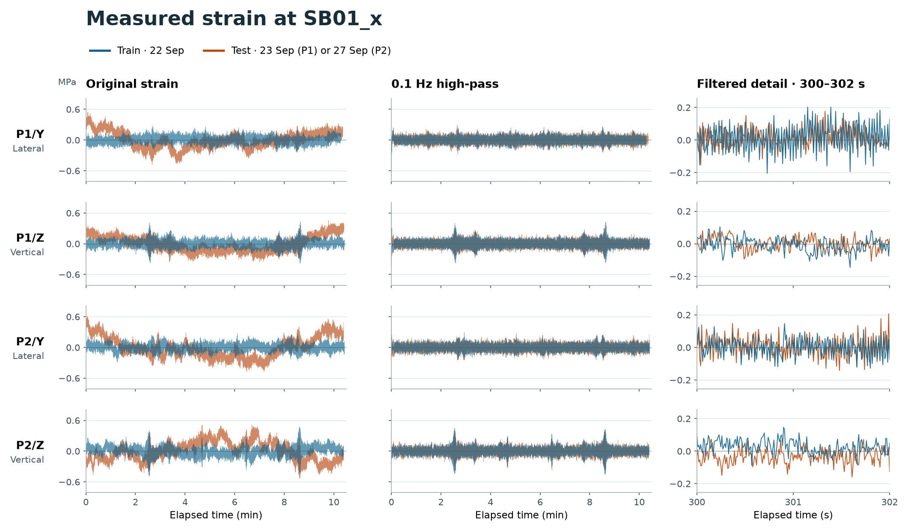

# 007 — Endpoint strain above 0.1 Hz

Does the [005 temporal CNN](005.md) predict held-out strain better relative to a constant when slower strain variation is attenuated?

Apply a second-order Butterworth high-pass filter (0.1 Hz at −3 dB, sampling rate 100 Hz) to `SB01_x` in each recording before constructing windows. Filter once forward, with the initial state corresponding to a constant strain equal to the first reading. The label at each timestamp uses strain measurements up to that timestamp. Filter state starts afresh on each recording. Keep the original 75 acceleration inputs and their fit-recording channel means.

Use the 005 architecture, optimizer, seed, batch size and early stopping. Train on the four `_02` undamaged sweeps, holding out each in turn for validation. Refit on all four for the rounded median best epoch. Score the same 1,981 endpoints on the four `_01` recordings. Each five-second window predicts one filtered strain value in MPa. This is a new target comparison. The saved 005 scores describe full-band strain, while 007 RMSE and R² describe the filtered target.

The constant reference predicts the sample-weighted mean of the eligible filtered strain labels from the fit recordings (stride one). Score it on the same validation and test timestamps as the CNN. All reported means weight recordings equally.



Across full recordings, filtered target standard deviations span 0.050–0.063 MPa on the four training sweeps (22 September) and 0.054–0.061 MPa on the four test sweeps (23 and 27 September).

## Running

[Experiment script](../experiments/highpass_strain_007.py) · [Configuration](../configs/007.yaml)

```sh
python -m experiments.highpass_strain_007 --config configs/007.yaml --data /path/to/data_100Hz.h5
```
